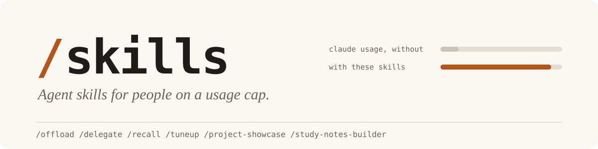

<p>
  <a href="https://moneytosms.github.io/skills/">
    <picture>
      <source media="(prefers-color-scheme: dark)" srcset="https://raw.githubusercontent.com/moneytosms/skills/main/assets/readme/skills-dark.svg">
      <source media="(prefers-color-scheme: light)" srcset="https://raw.githubusercontent.com/moneytosms/skills/main/assets/readme/skills-light.svg">
      
    </picture>
  </a>
</p>

# Skills For People On A Usage Cap

[](https://skills.sh/moneytosms/skills)

My Claude Code skills, straight from my `~/.claude`.

I'm on a Pro plan, and I kept running out of usage by midweek. Not on thinking, on legwork: reading files, grepping, summarizing logs, running tests. These skills move that legwork somewhere cheaper and keep my best model for the decisions.

Every one is manual. You type the slash command, nothing fires on its own. They're small, readable and easy to bend to your own setup. Fork them.

**[Website](https://moneytosms.github.io/skills/)** · **[Guide](https://moneytosms.github.io/skills/guide/)**

## Installation (30-second setup)

<details open>
<summary><strong>Claude Code plugin</strong> (updates itself)</summary>

```
/plugin install moneytosms-skills --marketplace moneytosms/skills
```

Or from your shell:

```bash
claude plugin marketplace add moneytosms/skills
claude plugin install moneytosms-skills@moneytosms
```

</details>

<details>
<summary><strong>Any other agent, or editable files</strong> (manual updates)</summary>

```bash
npx skills add moneytosms/skills
```

One skill only: `npx skills add moneytosms/skills --skill offload`

</details>

<details>
<summary><strong>By hand</strong></summary>

```bash
git clone https://github.com/moneytosms/skills
ln -s "$PWD/skills/skills/offload" ~/.claude/skills/offload
```

</details>

`/offload` needs the backends it calls: `codex` (logged in), `agy` or `opencode`. The others need only Claude Code.

## Why These Skills Exist

Each one fixes a way I was wasting usage.

### #1: I'm Burning My Limit On Grep And File Reading

> "The three great virtues of a programmer: laziness, impatience, and hubris."
>
> Larry Wall, _Programming Perl_

**The Problem.** Half of a coding session is legwork: summarize this file, find every use of that function, explain this log. My best model does it at full price, and on a Pro plan that's the week's limit gone by Wednesday.

**The Fix** is [`/offload`](./skills/offload/SKILL.md). It hands one low-judgment task to a model that isn't Claude: Codex on `gpt-6-luna`, Antigravity on Gemini Flash, or a free opencode model for public repos. Claude writes the prompt, reads a short answer back, and spot-checks the `file:line` refs.

```
/offload codex summarize desktop/.config/hypr/hyprland.lua
offload codex (gpt-6-luna) DONE in 50s. Full answer: .../answer.md
- Loading: runs Omarchy's defaults, then personal monitor, input, bindings ... (hyprland.lua:3-36)
```

It refuses prompts that look like they hold a secret, free models on repos it can't confirm are public, and edits on a dirty tree.

### #2: Big Tasks Eat My Best Model

> "Adding manpower to a late software project makes it later."
>
> Fred Brooks, _The Mythical Man-Month_

**The Problem.** A multi-ticket change means research, reading, editing and test runs. If the expensive model does all of it, it spends its context on file dumps instead of decisions.

**The Fix** is [`/delegate`](./skills/delegate/SKILL.md). The current model stays the orchestrator: it plans, asks you questions after recon, and reviews every diff. Headless Haiku workers do the legwork in parallel, each editor in its own git worktree with files it alone owns, so more workers don't mean more collisions.

> [!TIP]
> A lean worker starts at about 5k tokens of context instead of about 36k for a full subagent.

### #3: My Agent Keeps Making The Same Mistakes

> "Those who cannot remember the past are condemned to repeat it."
>
> George Santayana, _The Life of Reason_

**The Problem.** The same failed command, the same retry loop, the same correction I typed last week. Every repeat costs tokens, and memory files grow until nobody reads them.

**The Fix** is [`/recall`](./skills/recall/SKILL.md). It mines past sessions for failed and blocked tool calls, retry loops, heavy sessions and your corrections. Cheap scripts count, Haiku reads, Claude judges. You get a ranked, evidence-backed report, and it writes only the fixes you approve, within line budgets.

### #4: My Machine Is Slow And I Don't Know Why

> "Premature optimization is the root of all evil."
>
> Donald Knuth, _Structured Programming with go to Statements_

**The Problem.** Crashes, a full disk, slow boot. Guessing at fixes wastes a session, and a wrong deletion costs far more than a slow audit.

**The Fix** is [`/tuneup`](./skills/tuneup/SKILL.md). A swarm of read-only Haiku agents audits hardware, firmware, crash logs, disk, software and services on Linux, macOS or Windows. You get a ranked report with safety tiers, then only the fixes you approve, each previewed and measured.

## Other Skills I Use

- [`/project-showcase`](./skills/project-showcase/SKILL.md): turns a repo into a landing page, a searchable guide, a redesigned README and repo metadata. [This repo's site](https://moneytosms.github.io/skills/) is its output.
- [`/study-notes-builder`](./skills/study-notes-builder/SKILL.md): builds one polished PDF of exam-oriented study notes from lecture slides, notes or a topic list, with Typst.

## License

[MIT](./LICENSE). Timings quoted are single runs on one laptop.
